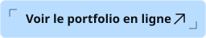
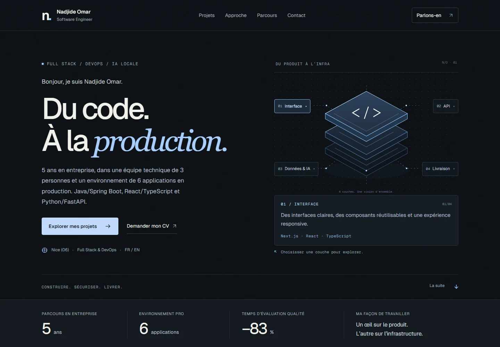

<div align="center">

<h1>Nadjide Omar</h1>

<p><strong>Software Engineer · Full Stack &amp; DevOps</strong></p>
<p>Portfolio de développement logiciel · Projets, parcours et mise en production</p>

<p>
  <a href="https://portfolio-ts-nine.vercel.app/">
    
  </a>
</p>

<p>
  <a href="https://portfolio-ts-nine.vercel.app/#projects">Projets</a> ·
  <a href="https://portfolio-ts-nine.vercel.app/#experience">Parcours</a> ·
  <a href="https://portfolio-ts-nine.vercel.app/#skills">Compétences</a>
</p>

<a href="https://portfolio-ts-nine.vercel.app/">
  
</a>

</div>

## À propos

Je développe des applications Full Stack avec **Java / Spring Boot**, **React / TypeScript** et **Python / FastAPI**. Ce portfolio rassemble mes projets personnels et les réalisations qui ont jalonné mes cinq années en entreprise, de septembre 2021 à septembre 2026.

| En production | Livraison | Résultat |
| :--- | :--- | :--- |
| **6 applications** dans l’environnement de l’équipe technique | **3 applications critiques** couvertes par la CI/CD GitHub Actions | **30 → 5 min** pour une évaluation sur la plateforme qualité |

[Lire le parcours et les réalisations en entreprise](https://portfolio-ts-nine.vercel.app/#experience)

## Projets

| Réalisation | Aperçu technique | Liens |
| :--- | :--- | :--- |
| **Sureau** · Projet principal | Gestion de parc informatique et atelier 2D/3D auto-hébergés. Java / Spring Boot, React / Three.js, PostgreSQL et Docker Compose. | [Fiche et vidéo](https://portfolio-ts-nine.vercel.app/?project=sureau) · [Code](https://github.com/Nadjide/sureau) |
| **Stajio** | Suivi de stage local-first, journal de bord, compétences et rapport révisable. Next.js, SQLite et IA locale facultative via Ollama. | [Fiche et vidéo](https://portfolio-ts-nine.vercel.app/?project=stajio) · [Code](https://github.com/Nadjide/stajio) |
| **DevOps Playground** | Laboratoire interactif React / Node.js. Missions de diagnostic, pipelines et rollback en simulation ou Docker local, stockage S3 / Azure Blob émulé. | [Fiche et captures](https://portfolio-ts-nine.vercel.app/?project=devops-playground) · [Code](https://github.com/Nadjide/devops-playground) |
| **Pokito** | Backend temps réel avec serveur autoritaire, Socket.IO, Supabase et Docker. | [Fiche](https://portfolio-ts-nine.vercel.app/?project=pokito) · [Code](https://github.com/Pokito-ynov/api-pokito) |

## Dans le dépôt

La vitrine est construite avec **Next.js 16, React 19 et TypeScript**, avec Tailwind CSS, Framer Motion et Vercel Analytics. Le schéma interactif présente quatre couches, de l’interface à la livraison. Les fiches projets sont partageables par URL et utilisables au clavier.

| Fichier | Contenu |
| :--- | :--- |
| [Vitrine](app/components/simple/SimpleView.tsx) | Présentation, schéma interactif, projets et parcours |
| [Profil](app/profileData.ts) et [parcours](app/portfolioContent.ts) | Textes et expériences professionnelles |
| [Données projets](app/projectsData.ts) | Fiches et technologies |
| [Notes de design](docs/design-references.md) | Références visuelles et choix de conception |

### Lancer en local

Prérequis **Node.js 24.x**.

```bash
npm ci
npm run dev
```

Le site est accessible sur [localhost:3000](http://localhost:3000).

| Commande | Usage |
| :--- | :--- |
| `npm run build` | Compiler le site pour la production |
| `npm run lint` | Vérifier le code avec ESLint |
| `npm test` | Vérifier la cohérence et la confidentialité des données |
| `npm run e2e` | Tester la navigation, les fiches projets et le responsive avec Playwright |

---

<div align="center">
  <strong>Nadjide Omar</strong> · <a href="https://github.com/Nadjide">GitHub</a> · <a href="https://www.linkedin.com/in/nadjide-omar">LinkedIn</a>
</div>
